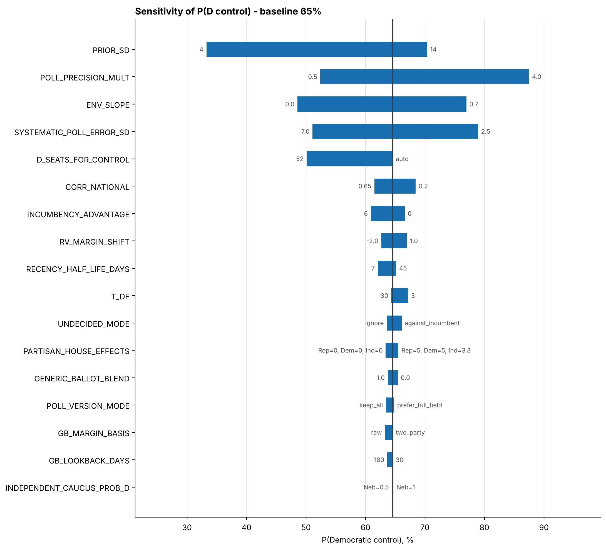
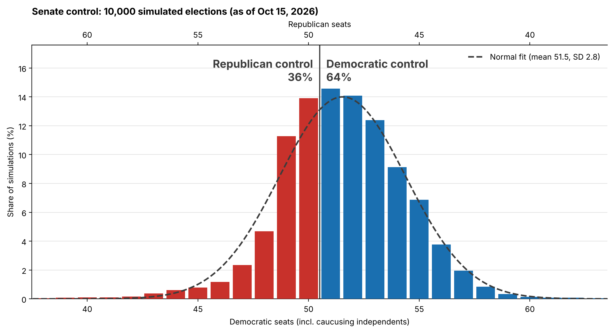

# Model 1: Configurable Senate Forecast

This is the companion doc for `senate_forecast_model.ipynb`. It covers what the model does, every assumption it makes, how to change those assumptions, how we tested it, and what the first results look like.

It's written for two kinds of readers on our team. If you're strong in code but new to political science, the "Why this matters" notes explain the polling and elections side. If you know political science but not Python, the "In the code" notes and the step-by-step guide to changing assumptions should be enough to work with the notebook without reading every line.

All the numbers below come from a run on **October 15, 2026**. If you rerun the notebook later the numbers will move, since new polls come in and the date changes.

---

## Contents

1. [The short version](#1-the-short-version)
2. [Running the model and changing assumptions](#2-running-the-model-and-changing-assumptions)
3. [The data](#3-the-data)
4. [How the model works](#4-how-the-model-works)
5. [Assumptions and settings](#5-assumptions-and-settings)
6. [Tests](#6-tests)
7. [Results](#7-results)
8. [What the outputs mean](#8-what-the-outputs-mean)
9. [Limitations](#9-limitations)
10. [Decisions we need to make](#10-decisions-we-need-to-make)

---

## 1. The short version

The model takes state Senate polls, presidential approval polls, and generic ballot polls, and turns them into a probability that each party controls the Senate after November 3.

As of October 15, with our current default assumptions:

| | |
|---|---|
| **Chance Democrats control the Senate** | **64%** |
| Median Democratic seats (incl. caucusing independents) | 51 |
| 80% range of Democratic seats | 48 to 55 |
| National environment | D+7.8 |
| Toss-ups | Alaska, Iowa |
| Lean D (R-held) | Ohio, Texas |

Two things are important to keep in mind:

1. First, several of the defaults are placeholders I picked, and we haven't agreed on them as a group. The sensitivity sweep (Section 6) shows that four of these settings can each swing the chance of Dem control by 25 to 37 points.
2. Second, the most important result from the testing isn't the 64%. In the competitive Republican-held states (Texas, Ohio, Alaska, Iowa), **the polls are more Democratic than those states' partisan lean would predict.** So whatever pushes the model toward the polls helps Democrats, and whatever pushes it toward partisan lean helps Republicans. How much to trust polls vs. partisan lean is the biggest decision we have to make (Section 10).

---

## 2. Running the model and changing assumptions

### Running it

1. Open `Model/senate_forecast_model.ipynb` in Jupyter or VS Code.
2. Run all cells. The main forecast takes a few seconds. The sensitivity sweep reruns the model about 70 times and takes a bit longer.
3. Results are saved to the `Output/` folder at the repo root (it gets created if it doesn't exist).

The notebook finds the data on its own as long as the folder layout stays the same (`Data/` and `Model/` both sitting in the repo root). You need `numpy`, `pandas`, `matplotlib`, `scipy`, and `openpyxl` (for the Excel files). The VoteHub API call uses Python's built-in `urllib`, so there's nothing extra to install for that.

### Changing an assumption

Every assumption lives in one dictionary called `CONFIG`, in the third cell. To change one:

1. Find the setting in the `CONFIG` cell. They're grouped by topic (poll weights, national environment, prior, and so on), and each one has a comment explaining it.
2. Change the value. For example, to make old polls fade faster:
   ```python
   "RECENCY_HALF_LIFE_DAYS": 14,   # was 21
   ```
3. Run all cells again.

A few settings are dictionaries instead of single numbers. Change the values inside the braces and keep the format the same:
```python
"PARTISAN_HOUSE_EFFECTS": {"Republican": 4.0, "Democrat": 4.0, "Independent/Dem": 2.0},
"STATE_PRIOR_ADJUSTMENTS": {"Maine": -4},   # adds a manual adjustment to one state
```

If you set something impossible (for example, correlations that add up to more than 1), the notebook stops right away with a message explaining what's wrong, instead of running and giving bad numbers.

### Testing an assumption with the sweep

At the bottom of `CONFIG` is `SWEEP_PARAMS`. Each entry is a setting name and a list of values to try:
```python
"RECENCY_HALF_LIFE_DAYS": [7, 14, 21, 30, 45],
```
The sweep reruns the model once for each value, changing **only that one setting** and leaving everything else at its default. To test something new, add a line with the setting name and the values you want. To make the notebook run faster while you're experimenting, set `"RUN_SWEEP": False`.

### Rerunning as of an earlier date

Setting `"AS_OF_DATE": "2026-10-01"` reruns the model as if it were that day. Any poll released after that date is dropped. This is useful for seeing how the forecast has changed over time.

---

## 3. The data

### Inputs

| File | What's in it | Notes |
|---|---|---|
| `Data/Midterm_Polls.xlsx` | 226 state Senate polls, Aug 27 to Oct 14 | Covers 27 of the 35 races. Michigan and Texas have the most (26 surveys each). |
| `Data/National_Polls.xlsx` | 34 presidential approval polls | Approval and disapproval, sample size, population, pollster rank |
| `Data/leans_and_regions.csv` | Cook Partisan Voting Index (PVI) and Census region for every state | |
| VoteHub API | Generic ballot polls ("would you vote for the Democrat or the Republican for Congress?") | Pulled live each run. A copy is saved to `Output/generic_ballot_cache.csv` in case the API is down next time. |


**Eight races have no polls at all:** Colorado, Delaware, New Jersey, Oklahoma, Oregon, Virginia, West Virginia, and Wyoming. None of them are competitive, and the model forecasts them from partisan lean and the national environment alone.

### Cleaning

All cleaning happens in code. **We never edit the shared spreadsheets.**

- **Pollster names.** A few names were misspelled or spelled two ways ("St. Pete Pols" / "St.Pete Polls", "Morning consult" / "Morning Consult", "Cygnal Politial"). These are fixed so the model knows they're the same pollster. This matters because the model limits how much one pollster can dominate a state, which only works if it can tell pollsters apart.
- **Survey versions.** About 50 rows are really the same survey reported two or three ways: a head-to-head version, a full-field version with third-party candidates, and sometimes a generic party version. Counting each one as a separate poll double counts the same respondents. The model groups rows with the same pollster, state, and end date as one survey. By default it keeps every version but gives the survey only one poll's worth of weight in total (`POLL_VERSION_MODE = "split"`). After cleaning there are 217 rows from 199 distinct surveys.
- **Small fixes.** One row says "lV" instead of "LV". One AlphaROC approval poll is listed twice. The Winston Group approval poll has a sample size of 0, which would give it zero weight, so it gets 1,000 instead.
- **Generic ballot duplicates.** Ipsos and YouGov sometimes release the same survey for registered voters and for all adults. Only the more voter-like version is kept.

---

## 4. How the model works

The model works in five stages. Each one is a section in the notebook.

```
State polls ──► weighted state averages ──┐
                                           ├──► combine (Bayesian update) ──► simulate 10,000 elections ──► seat counts
Partisan lean + national environment ─────┘        (the "prior")
       ▲
Approval + generic ballot
```

### 4.1 Weighting the polls

Not every poll is equally useful, so each poll gets a weight, and the state average is a weighted average. The weight is several factors multiplied together:

| Factor | Idea | Default |
|---|---|---|
| Recency | Older polls count less. The weight halves every 21 days. | `RECENCY_HALF_LIFE_DAYS = 21` |
| Sample size | Bigger samples count more, with diminishing returns (square root), capped at 2,500. | `REFERENCE_SAMPLE = 800` |
| Population | Likely voters (LV) are closest to who actually shows up. Registered voters (RV) and all adults (A) count less. | LV 1.0, RV 0.85, A 0.7 |
| Partisan sponsor | Polls paid for by a party or campaign count less. | 0.6 (0.75 for Independent/Dem) |
| Generic ballot | A state poll that asks "Democrat or Republican" without naming candidates counts less. | 0.5 |
| Full field | Polls listing every candidate count slightly less than head-to-heads (the sample code's hypothesis). | 0.9 |
| Pollster quality | Based on VoteHub's pollster rank, from 5 (lowest or unrated) to 10 (A+). | rank 5 = 0.5, rank 10 = 1.0 |
| Accuracy | Pollsters with smaller historical errors count more. **Right now everyone uses the same default error**, since that data isn't filled in yet. | 4.0 points |
| Flooding | One pollster with many surveys in a state can't take over that state's average. | each of k surveys gets 1/√k |
| Survey version | Splits one survey's weight across its versions (see Section 3). | split |

After weighting, some margins get **shifted** to correct for known biases:
- **RV polls** are nudged 0.5 points toward Republicans (`RV_MARGIN_SHIFT`), since registered voter samples have historically leaned a little Democratic compared to who actually votes.
- **Partisan-sponsored polls** are shifted 3 points against the sponsor (`PARTISAN_HOUSE_EFFECTS`). Polls that campaigns choose to release tend to make their own side look better.

**Why this matters.** The averaging logic is basically what FiveThirtyEight, Silver Bulletin, and others do. The weights are judgment calls, and the sweep shows that most of them don't move the forecast much (Section 6).

**In the code.** `weight_polls()` builds a column for each factor (`w_recency`, `w_size`, and so on) and multiplies them together into `weight`. The "Looking under the hood" cell in Step 9 shows these columns for one state, which is the easiest way to see why a particular poll counts more or less than another.

### 4.2 Undecided voters

Most polls have some voters who didn't pick either candidate. The model assumes that in head-to-head polls all of them are undecided. In full-field polls, it assumes half of them are real third-party supporters and half are undecided (`OTHER_TO_UNDECIDED_FULL_FIELD = 0.5`, a guess).

The default is that undecideds break the same way decided voters do (`UNDECIDED_MODE = "proportional"`). So a 47-43 poll with 10% undecided is treated as roughly a 4.4-point lead, not 4. The other options are to ignore undecideds (what the sample code did), give Democrats a fixed share, or have undecideds lean toward the challenger.

Since we don't actually know how undecideds will break, races with more undecideds also get more uncertainty.

### 4.3 The national environment

Midterms tend to be a referendum on the president's party. The model estimates how good a year it is for Democrats nationally in two ways and averages them 50/50 (`GENERIC_BALLOT_BLEND = 0.5`).

- **From approval.** Weighted net approval (approve minus disapprove) is **-22.8**. Each point of net approval is worth 0.35 points of margin (`ENV_SLOPE`), which gives **D+8.0**. The 0.35 comes from 2018: Trump's net approval was around -10 and Democrats won the House popular vote by 8.6, which works out to a slope somewhere between 0.3 and 0.5.
- **From the generic ballot.** The 10 most recent VoteHub generic ballot polls average **D+7.6** after converting them to two-party share.

Blended, that's **D+7.8**.

**Why this matters.** A state with a PVI of 0 should vote about like the country does, so the national environment can be added straight on top of each state's lean.

### 4.4 The prior and the Bayesian update

Before looking at any state polls, the model makes a baseline guess for every race, called the **prior**:

> prior margin = 2 × PVI + national environment + incumbency + any manual adjustment

The PVI is doubled because it's measured in vote share, and one point of share is two points of margin. Elected incumbents running for reelection get 2 points. Appointed incumbents (Florida, Ohio, and South Carolina) get 1 point. Open seats get nothing.

Next, the prior and the state polling average are combined. **Whichever one is more certain gets more say.** Statistically this is a precision-weighted average, also called a normal-normal Bayesian update. In practice:
- A state with no polls (like Wyoming) is 100% prior.
- A heavily polled state (like Texas or Michigan) ends up about 70% polls and 30% prior.

Even the most-polled states never get past about 70% polls. That's because of `SYSTEMATIC_POLL_ERROR_SD = 4.5`: every poll in a state can miss in the same direction, so adding more polls doesn't remove that error. This ends up being one of the most important settings in the model.

Last, the model adds some uncertainty for the 19 days left before the election (`DAILY_DRIFT_SD`), since opinion can still move.

### 4.5 Simulating the election

The model simulates the election 10,000 times. In each simulation every race gets a random error, and whoever is ahead after the error wins.

- **Fat tails.** The errors come from a t-distribution (`T_DF = 5`), not a normal distribution, so big upsets happen a bit more often. This matches how real elections behave.
- **States move together.** If polls underestimate Republicans in Iowa, they probably underestimated them in Kansas too. Every pair of states shares some correlation: 0.45 for everyone (a national polling miss), +0.15 if they're in the same Census region, and up to +0.15 more if they have similar partisan lean.
- **Bad polling years.** In each simulation, one shared draw can make the polling miss bigger everywhere at once (`SHARED_TAIL_SCALE`).
- **Nebraska.** Dan Osborn is an independent. If he wins, the model flips a weighted coin to decide whether he caucuses with Democrats (80% by default).

Each simulation then counts the seats: 34 Democratic holdovers (including King and Sanders), plus whatever Democrats and caucusing independents win. **Democrats need 51** because the Vice President breaks 50-50 ties.

**In the code.** `correlation_matrix()` builds the 35 × 35 correlation matrix. `unit_shocks()` makes the correlated, fat-tailed errors. `national_simulations()` counts the seats.

---

## 5. Assumptions and settings

`CONFIG` has about 90 settings. The ones below matter the most, either because the sweep shows they move the forecast or because they're basic choices about how the model works. The "Swing" column is the range of P(Dem control) we got when sweeping that setting (Section 6).

### The settings that matter most

| Setting | Default | What it means | Raising it... | Swing |
|---|---|---|---|---|
| `PRIOR_SD` | 7.5 | How far a race can stray from lean + environment. Basically how much we trust partisan lean. | Trusts lean **less** and polls more. Currently helps Dems. | 33% to 70% |
| `POLL_PRECISION_MULT` | 1.0 | Directly scales how much the polls count against the prior. | Trusts polls more. Currently helps Dems. | 52% to 88% |
| `ENV_SLOPE` | 0.35 | Points of margin per point of net approval. | Makes the president's unpopularity matter more. Helps Dems. | 49% to 77% |
| `SYSTEMATIC_POLL_ERROR_SD` | 4.5 | How much all polls in a state can miss together. | Polls are trusted less. Currently hurts Dems. | 51% to 79% |
| `D_SEATS_FOR_CONTROL` | auto (51) | Seats Democrats need. 52 is the "Fetterman switches" scenario. | | 50% at 52 seats |
| `CORR_NATIONAL` | 0.45 | How much every state moves together. | Spreads out the seat distribution. Hurts the favorite. | 62% to 68% |
| `INCUMBENCY_ADVANTAGE` | 2.0 | Points for an elected incumbent running again. | Helps Collins (Maine) and Sullivan (Alaska). | 61% to 67% |
| `RV_MARGIN_SHIFT` | -0.5 | Points RV polls get nudged (negative = toward R). | Toward 0 or positive helps Dems. | 63% to 67% |
| `RECENCY_HALF_LIFE_DAYS` | 21 | Days until a poll counts half as much. | Older polls keep more weight. | 62% to 65% |
| `T_DF` | 5 | Tail thickness. Lower means more upsets. | Thinner tails. | 64% to 67% |
| `UNDECIDED_MODE` | proportional | How undecideds break. | | 64% to 66% |
| `PARTISAN_HOUSE_EFFECTS` | R 3, D 3, Ind/D 2 | Points shifted against a poll's sponsor. | | 63% to 66% |
| `GENERIC_BALLOT_BLEND` | 0.5 | Share of the environment from the generic ballot (vs approval). | | 64% to 65% |
| `POLL_VERSION_MODE` | split | How multi-version surveys count. | | 63% to 65% |
| `INDEPENDENT_CAUCUS_PROB_D` | Nebraska 0.8 | Chance Osborn caucuses with Dems if he wins. | | under 1 point |

There are also some settings that aren't in the sweep but that you should know about:

| Setting | Default | What it means |
|---|---|---|
| `INCUMBENT_STATUS` | built by hand | Which seats are open, which incumbents are running, and which are appointed. I put this together from news reports on Oct 15 (Texas and Louisiana became open when Cornyn and Cassidy lost their primaries; South Carolina's Darline Graham is an appointed incumbent). **Double-check this before the final run.** |
| `STATE_PRIOR_ADJUSTMENTS` | none | Manual points added to a single state's prior. This is where candidate quality or local knowledge would go. |
| `ENV_OVERRIDE` | none | Set the national environment directly (5.0 = D+5) and skip approval and the generic ballot. |
| `AS_OF_DATE` | today | Rerun the model as of a past date. |
| `N_SIMS` / `SEED` | 10,000 / 2026 | Number of simulations, and the random seed that makes results reproducible. |
| `RATING_TOSSUP` / `LEAN` / `LIKELY` | 0.60 / 0.75 / 0.95 | Cutoffs for race ratings. "Safe" means the favorite wins 95%+ of the time. |

### Everything else, by group

- **Files and run settings.** Where the data lives, where outputs go, and the election date.
- **Senate map.** Which seats are up and who holds them (`SEATS_UP`), holdover counts, which party holds the VP, and the chance a holdover senator switches sides (`HOLDOVER_DEFECTION_PROB`, 0 by default).
- **Cleaning.** Pollster name fixes, minimum sample size, maximum poll age, and how to treat blank `Bigger_Field` values. None of these change the current results much. They're there so we can be strict about data if we want to.
- **Undecideds.** How much of "other" is undecided in each poll type, the share for the `fixed_share` and `against_incumbent` modes, and how uncertain the split is (`UNDECIDED_SPLIT_SD`).
- **Poll weights.** The individual multipliers listed in Section 4.1, plus the pollster quality scale and `TYPICAL_ERROR_BY_POLLSTER`, which is **empty until we fill it in from the VoteHub scorecards.**
- **Optional estimated house effects.** `ESTIMATE_HOUSE_EFFECTS` measures each pollster's lean from our own data and removes it. It's off because most pollsters only have one or two polls, so the estimates would mostly be noise.
- **National environment details.** Half-lives, population weights, and the partisan weight for national polls. A per-population shift for approval (`NAT_NET_APPROVAL_SHIFT`, currently 0). For the generic ballot: lookback window, minimum number of polls, two-party vs raw margins, and whether to apply the RV shift.
- **Prior details.** PVI-to-margin conversion (2.0), how much each state moves with the national environment (`ENV_ELASTICITY`, 1.0 everywhere), the appointed-incumbent bonus, and a wider prior for races with an independent (`INDEPENDENT_PRIOR_SD_MULT = 1.3`).
- **Drift.** Uncertainty per day until the election, and whether it grows with the square root of time or linearly.
- **Correlation details.** Region and lean correlation, how quickly lean similarity fades (`LEAN_SCALE`), and manual overrides for specific state pairs.
- **Sweep settings.** Whether to run the sweep, simulations per run, which states to track, and the values to try.

---

## 6. Tests

We tested the model in two ways: (A) a sensitivity sweep that changes one assumption at a time, and (B) a set of checks to make sure the code does what it's supposed to.

### 6A. Sensitivity sweep

The sweep reran the model 70 times, once for each value of each of the 17 settings in `SWEEP_PARAMS`. Each run used 3,000 simulations and the same random seed, so differences come from the setting and not random noise.



*Each bar goes from the lowest to the highest chance of Dem control we got while changing that one setting. The labels at the ends show which value produced each extreme. The vertical line is the baseline.*

**What we found**

1. **Four settings dominate.** `PRIOR_SD`, `POLL_PRECISION_MULT`, `ENV_SLOPE`, and `SYSTEMATIC_POLL_ERROR_SD` each move P(Dem control) by 28 to 37 points. Other than the 51-vs-52 seat rule, every other setting moves it by 7 points or less. Three of those four are about the same question: how much to trust state polls vs. partisan lean.
2. **The direction is consistent.** Trusting the polls more always helps Democrats. In Texas, the polls say D+3.2 and the prior says R+4.2. Ohio is D+3.8 vs R+3.2, and Alaska is D+2.9 vs R+6.2. The more weight the model gives the polls, the more those states move toward Democrats.
3. **Maine and Michigan go the other way.** There, the prior is *more* Democratic than the polls. Maine's polls say D+2.1, but the prior says D+13.8 (PVI +4, doubled, plus the D+7.8 environment, minus Collins's 2 incumbency points). The model ends up at D+5.5. Michigan's polls say D+3.2 and the prior says D+7.8, giving D+4.5. If you think Collins outruns her state's lean, as she did in 2020, the prior is overrating Democrats in Maine. `STATE_PRIOR_ADJUSTMENTS` is how we'd fix that.
4. **The smaller choices barely matter.** How we handle duplicate survey versions, undecided voters, partisan house effects, the generic ballot blend, and Osborn's caucus choice each move the result by 3 points or less. That's reassuring, since these are the choices we have the least evidence for.
5. **The 51 vs 52 question is big.** Requiring 52 seats (the Fetterman scenario) drops Dem control from 65% to 50%.

**Which races are most sensitive.** Alaska, Texas, Ohio, Iowa, and Nebraska move by 15 to 50 points across the `PRIOR_SD` and `POLL_PRECISION_MULT` values. North Carolina barely moves under any setting (95% D or higher every time), since its polls and prior both agree that Democrats are clearly ahead. The full table is at the bottom of the notebook and in `Output/sensitivity_sweep.csv`.

### 6B. Checks that the code works

| Check | What we did | Result |
|---|---|---|
| Reproducibility | Ran the model twice with the same seed | Identical seat counts in every simulation |
| Simulation noise | Changed the seed (1, 99, 2026) | P(Dem control) 64.3% to 65.5%, so about ±1 point is just noise at 10,000 sims |
| Rerun as of past dates | `AS_OF_DATE` = Sep 15, Sep 25, Oct 1, Oct 8 | 53%, 66%, 62%, 66% (today: 64%). Each run only used polls available that day. |
| No approval polls yet | As of Sep 15, before the first approval poll in our file | Fell back to the generic ballot alone with no errors |
| Neutral environment | `ENV_OVERRIDE = 0` | 33% Dem control, which shows how much of the result depends on the national environment |
| President's party flipped | `PRESIDENT_PARTY = "D"` | Approval effect flips sign, as expected |
| VP tiebreak flipped | `VP_PARTY = "D"` | Dems need 50, and control goes up to 78% |
| Holdover switches | `HOLDOVER_DEFECTION_PROB` = 1.0 for Fetterman | Median seats drop by 1, and control drops to 50% |
| Every option for each mode | All undecided modes, version modes, drift shapes, normal vs t, shared tails on/off, estimated house effects on | All run without errors, and results stay in a reasonable 61% to 66% range |
| Bad correlation overrides | Added an Iowa-Kansas override of 0.95 and a Texas-Iowa override of -0.5 | The matrix is repaired automatically and the run finishes |
| Invalid settings | `T_DF = 2`, correlations that add up to 1, a typo in a sweep key | Each one stopped with a clear error message, as it should |
| Duplicate handling | Checked weights after splitting survey versions | No survey gets more than one poll's worth of weight |
| Name cleaning | Checked which pollster spellings got merged | The four known typos were fixed, and nothing else was merged by mistake |

---

## 7. Results

*As of October 15, 2026, with all defaults.*

### Senate control



Democrats win control in **64%** of simulations. The most common outcomes are 50 to 53 Democratic seats, and the distribution is centered just above the 51-seat line. The dashed line is a normal curve, just for reference.

### Competitive races

| State | Holder | Seat | Polls | Prior | Model | P(Dem win) | Rating |
|---|---|---|---|---|---|---|---|
| North Carolina | R | open | D+10.4 | D+5.8 | D+9.0 | 98% | Safe D |
| Minnesota | D | open | D+3.1 | D+13.8 | D+6.8 | 95% | Likely D |
| Maine | R | Collins | D+2.1 | D+13.8 | D+5.5 | 92% | Likely D |
| Michigan | D | open | D+3.2 | D+7.8 | D+4.5 | 88% | Likely D |
| Ohio | R | appointed | D+3.8 | R+3.2 | D+1.6 | 66% | Lean D |
| Texas | R | open | D+3.2 | R+4.2 | D+1.0 | 61% | Lean D |
| Alaska | R | Sullivan | D+2.9 | R+6.2 | D+0.1 | 50% | Toss-up |
| Iowa | R | open | D+1.0 | R+4.2 | R+0.6 | 43% | Toss-up |
| Kansas | R | Marshall | D+1.5 | R+10.2 | R+2.3 | 26% | Lean R |
| Nebraska (Ind) | R | Ricketts | R+0.3 | R+14.2 | R+3.7 | 19% | Likely R |
| South Carolina | R | appointed | R+1.5 | R+9.2 | R+4.5 | 14% | Likely R |
| Florida | R | appointed | R+6.3 | R+3.2 | R+5.3 | 9% | Likely R |

*"Polls" is the weighted polling average after adjustments. "Prior" is lean + environment + incumbency. "Model" is the combined estimate.*

Everything else is rated Safe. That includes Georgia (97% D) and New Hampshire (98% D), which both have solid polling leads.

**How to read this.** If Democrats hold all 13 of their own seats (Michigan, at 88%, is the shakiest), they're at 47. To reach 51 they need 4 of the Republican-held seats. North Carolina and Maine are likely, and Ohio and Texas lean their way, so the path to a majority mostly runs through those four. Alaska and Iowa are the backups.

### States moving together

When Democrats win one state, their chances go up in related states:

| If Dems... | then P(Dem wins...) goes from | to |
|---|---|---|
| win Iowa | Kansas: 26% | 50% |
| lose Iowa | Kansas: 26% | 8% |
| win Texas | Alaska: 50% | 66% |
| lose Texas | Alaska: 50% | 25% |
| lose North Carolina | Georgia: 97% | 49% |

This is why we can't just add up the individual win probabilities to get a seat count. Wins and losses come in clusters.

---

## 8. What the outputs mean

Everything is saved to `Output/` each time the notebook runs.

| File | What it is |
|---|---|
| `state_win_probabilities.csv` | The simple table: projected margin, P(Dem win), P(Rep win), and rating for each race. Start here. |
| `race_probabilities.csv` | The detailed table with every step: lean, number of surveys, undecided share, polling average, prior, how much of the estimate came from polls, final estimate and its uncertainty, and win probabilities from both simulation types. |
| `seat_distribution.csv` / `.png` | How many simulations ended with each number of Democratic seats, and the chart. |
| `sensitivity_sweep.csv` | One row per sweep run: which setting, which value, P(Dem control), average seats, national environment, and P(Dem win) for each tracked state. |
| `sensitivity_tornado.png` | The sensitivity chart from Section 6. |
| `config_snapshot.json` | Every setting used for this run. If you ever wonder where a set of numbers came from, this tells you. |
| `generic_ballot_cache.csv` | The last successful VoteHub pull, used as a backup if the API is down. |

**Column guide for `race_probabilities.csv`**

| Column | Meaning |
|---|---|
| `poll_mean` | Weighted polling average (D minus R) after house-effect adjustments |
| `prior_mean` | What we'd expect from lean + environment + incumbency alone |
| `poll_share_of_estimate` | 0 means the estimate is all prior, 1 means it's all polls |
| `post_mean` | The final estimated margin |
| `post_sd` | Uncertainty around that margin, in points. About two-thirds of simulated outcomes land within ±1 of this. |
| `p_dem_state_sim` | P(Dem win) from independent simulations |
| `p_dem_national_sim` | P(Dem win) from the correlated simulations. This is the one used everywhere else. The two should be nearly identical. |

---

## 9. Limitations

1. **Several key settings are placeholders.** The four that matter most were set by me without any calibration. Their values are reasonable, but we haven't tested them against past elections.
2. **No backtest.** We haven't run the model on 2018, 2022, or 2024 polls to see how it would have done. That would be the best way to set `PRIOR_SD`, `SYSTEMATIC_POLL_ERROR_SD`, and `ENV_SLOPE`, but it would require historical poll data we don't have yet.
3. **Pollster accuracy isn't filled in.** Every pollster uses the same 4-point default error until we add the VoteHub scorecard numbers.
4. **The generic ballot data is thin.** VoteHub's API has about 50 generic ballot polls a month from March through June, but only 12 from July through October. The model currently uses the 10 most recent (going back to July). This is most likely a gap in VoteHub's coverage, not fewer polls being run.
5. **Incumbent status was collected by hand.** There's no free API for which incumbents are running, so it was built from news reports. It needs to be checked again before any final forecast.
6. **Partisan lean doesn't capture candidates.** The prior treats Maine like any D+4 state, but Collins has outrun her state's lean before. Candidate quality only enters through the polls, or through `STATE_PRIOR_ADJUSTMENTS` if we add it by hand.
7. **Major events aren't modeled yet.** The events listed in `Data/Major events.docx` don't affect the forecast. We decided to add them later.
8. **Eight races have no polls.** None of them look competitive, but their forecasts rest entirely on partisan lean.

---

## 10. Decisions we need to make

These are the defaults marked `TODO` in `CONFIG`, ordered by how much they matter. The sweep evidence for each is in Section 6.

### High impact

1. **How much should we trust state polls vs partisan lean?** (`PRIOR_SD`, `POLL_PRECISION_MULT`, `SYSTEMATIC_POLL_ERROR_SD`)
   This is the biggest decision. Depending on these three settings, the forecast ranges from 33% to 88% Dem control. Right now the polls in Texas, Ohio, Alaska, and Iowa are 5 to 9 points more Democratic than partisan lean predicts. Do we believe the polls this year, or do we expect those states to come back toward their usual lean? Some reference points: Senate polling averages have historically missed by about 4 to 5 points, and polls underestimated Republicans in 2016, 2020, and 2024, but were fairly accurate in 2018 and 2022.

2. **How much does presidential approval matter?** (`ENV_SLOPE`)
   With a slope of 0 (approval doesn't matter, only the generic ballot does) Dem control is 49%, and with a slope of 0.7 it's 77%. The 0.35 default comes from one election (2018). We could look at 2006, 2010, 2014, 2018, and 2022 to pin it down better.

3. **Do we model the Fetterman scenario?** (`D_SEATS_FOR_CONTROL`, `HOLDOVER_DEFECTION_PROB`)
   51 seats needed gives 65% Dem control, and 52 gives 50%. The sample code said to stick with 51 unless new information comes out. We could also set a probability between 0 and 1 instead of choosing one or the other.

### Medium impact

4. **Should we adjust Maine (and other states) for candidate strength?** (`STATE_PRIOR_ADJUSTMENTS`, `INCUMBENCY_ADVANTAGE`)
   The prior puts Maine at D+13.8, mostly because it's a D+4 state in a D+8 year. Collins has historically run well ahead of her state's lean. A manual adjustment of a few points toward Republicans would bring the prior closer to the polls.

5. **How much do states move together?** (`CORR_NATIONAL`)
   The default is 0.45. Higher values spread out the seat outcomes and make the result less certain in both directions (62% to 68% across our range).

6. **What should the race rating cutoffs be?** (`RATING_TOSSUP`, `RATING_LEAN`, `RATING_LIKELY`)
   Currently 60/75/95. These don't affect the forecast, only the labels.

### Low impact, but needs doing

7. **Fill in pollster accuracy** (`TYPICAL_ERROR_BY_POLLSTER`) from the [VoteHub pollster scorecards](https://votehub.com/polls/pollster-scorecards/).
8. **Re-check `INCUMBENT_STATUS`** before the final run.
9. **How much of "other" in full-field polls is real third-party support?** (`OTHER_TO_UNDECIDED_FULL_FIELD`, currently a 50/50 guess.) This mostly affects Montana, Idaho, and Illinois, which have 13 to 15% "other," and none of those races are competitive.
10. **Should adults-only approval polls be adjusted?** (`NAT_NET_APPROVAL_SHIFT`) Polls of all adults show lower approval than polls of registered voters in our data. Right now they're down-weighted but not shifted.
11. **Decide how to add major events** (`Data/Major events.docx`). We agreed to come back to this.
