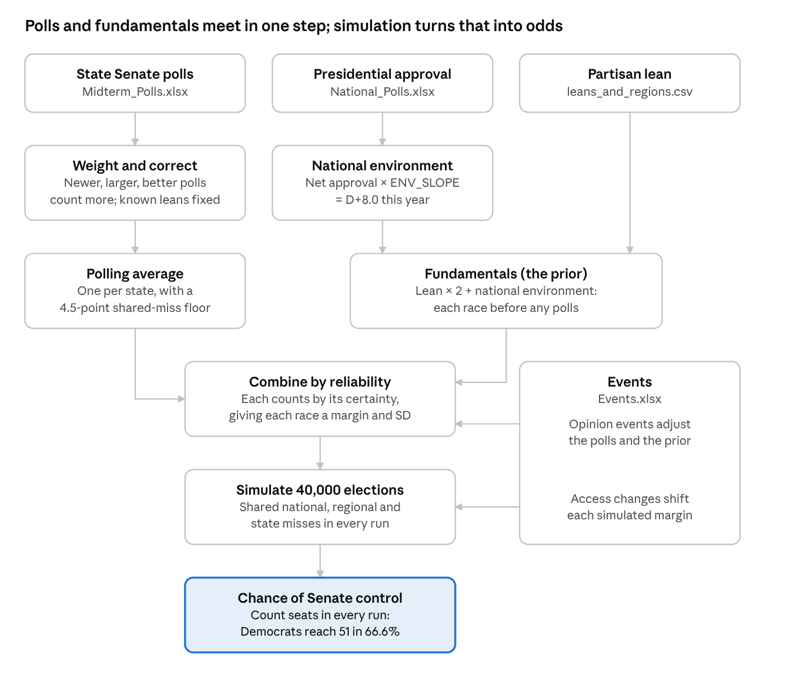

# How The Senate Forecast Works: A Guide for Policy and Coding Students

Oct 16, 2026 · @Rylyn

## Who this is for

The model answers one question: what is the chance that Democrats control the Senate after November 3? Using the October 15 data, the answer is 66.6%. This guide explains how the model reaches that number. It is written for two groups who each know half of the story.

- **Policy students who don't code:** read the flow, the Iowa example and the section for policy students. You can judge most of the important choices without opening the code.
- **Coding students who don't study policy:** read the flow, the Iowa example and the section for coding students. The math is simple. The hard part is knowing which numbers political science backs up.
- **Everyone:** the vocabulary table and "Who decides what" show how the two groups split the work.

All the margins in this guide are the Democrat minus the Republican, in percentage points. D+3 means the Democrat leads by 3 points. R+3 means the Republican leads by 3, which the code stores as −3. Each setting, its tested range and how much it moves the result are listed in [Variables and Choices](variables_and_choices.md).

## The model at a glance

Read the diagram from top to bottom. The left column is the polls. The middle and right columns are the fundamentals. The events come in from the side. Everything meets at one step, "Combine by reliability," which is why the settings that decide that step matter most.

## One race, start to finish: Iowa

Iowa begins as 21 polls averaging D+0.5 and ends with Democrats at a 44% chance to win. It's a good race to follow because the polls and the fundamentals disagree, and the model has to decide between them.

| Step | What happens | Iowa on October 15 |
| --- | --- | --- |
| 1. Collect polls | Every Iowa Senate poll in `Midterm_Polls.xlsx` | 21 polls, August 31 to October 15. Simple average D+0.5 |
| 2. Weight each poll | Newer, larger, better-rated polls count more. Sponsored polls, generic questions and repeat releases of one survey count less | Marist's October 15 poll counts the most. Co/Efficient's generic-ballot version counts about 1/50 as much. The 21 polls carry as much information as 11.7 equal polls |
| 3. Correct known leans | Registered-voter polls move 1 point toward Democrats. Party-sponsored polls move 3 points away from the sponsor | Trafalgar (Republican-sponsored) goes from R+2 to D+0.9 |
| 4. Average the polls | A weighted average, with an uncertainty that never drops below the 4.5-point miss that all polls in a state can share | D+1.1, give or take 4.9 points |
| 5. Build the fundamentals | Partisan lean × 2, plus the national environment (net approval of −22.9 × 0.35 = D+8.0) | Lean R+6 gives −12. Adding 8.0 gives R+4.0, give or take 7 points |
| 6. Combine | Each source counts in proportion to how certain it is. The polls are more certain, so they get more weight | The polls get 67%, the fundamentals 33%: R+0.5 |
| 7. Allow for change | 19 days are left, and opinion can drift 0.28 points per day (spread as √19) | Total uncertainty: 4.2 points |
| 8. Simulate 40,000 elections | Each simulation draws a national polling miss, a regional miss and an Iowa-only miss | Democrats win Iowa in 44% of simulations |
| 9. Count seats | Add each simulation's winners to the 34 Democratic seats not up this year | When Democrats win Iowa, they control the Senate 95% of the time. When they lose it, 44% |

Notice step 6. The polls say D+1.1, the fundamentals say R+4.0, and the forecast lands in between, closer to the polls. That one compromise, repeated in each battleground, explains why the settings that set each side's uncertainty (`PRIOR_SD` and `SYSTEMATIC_POLL_ERROR_SD`) move the final number so much.

## For policy students: what the code is doing

Every step in the code rests on one of five ideas. None of them needs programming to understand, and most of them can be argued about without opening the code.

### A weight is a multiplier

A poll with weight 0.5 counts half as much as a poll with weight 1. Weights multiply, so a party-sponsored poll (0.5) of registered voters (0.85) counts 0.425. Each weight is a judgment about how much to trust a kind of evidence. That is a policy-style question, not a coding question.

### An average is only as sure as its shared mistakes

The margin of error printed with a poll only counts sampling luck. Real polls also miss because of who answers and how the pollster models turnout, and those misses hit every poll in a state at once. So after 20 polls, the model still allows a 4.5-point shared miss. Adding a 21st poll can't remove it.

### Two sources combine by how reliable each one is

The fundamentals (how the state usually votes, plus the national mood) and the polls are two witnesses. Each one counts in proportion to its reliability. A state with many recent polls leans on the polls. A state with none falls back on the fundamentals. This is the same logic as weighing a long-running program evaluation against a single new study.

### Simulation is counting, not prediction magic

No simple formula gives the chance of every combination of 35 races. So the computer runs the election 40,000 times. In each run, every race gets a random miss of a realistic size. It counts how often Democrats reach 51 seats. 66.6% means they reached 51 in 26,658 of the 40,000 runs.

### Races move together

If the polls overstate Democrats in Iowa, they probably do in Kansas too. The model builds this in: every run includes one national miss that all states share, one regional miss and one miss for states with similar politics. Without it, the model would treat a sweep as nearly impossible, when sweeps happen in wave years.

### What 66.6% does and doesn't mean

It isn't a vote share, and it isn't a call that Democrats will win. It says the Republican outcome happens in about one run out of three. If Republicans keep the Senate, the model wasn't necessarily wrong, any more than a 33% chance of rain is wrong on a day it rains. A forecast is judged over many calls, by whether its 70% calls come true about 70% of the time.

### What you can do without coding

Open `senate_event_model.py` in any text editor. The SETTINGS block at the top reads like a list, and each line has a comment that explains it. Change a number, save, and run the file. The results land in the `outputs` folder as CSV files, which open in Excel. The voting-access and opinion events live in `Events.xlsx`, so you can add or edit them without touching code.

## For coding students: the political science behind the code

The code is a weighted average, a Bayesian update and a Monte Carlo loop. What decides whether it is right is the political science behind each constant. Here is the reasoning behind each step.

### Partisan lean is the baseline

A state's lean is how much more Democratic or Republican it votes than the country as a whole. Most voters' party loyalty is stable, and ticket splitting has collapsed, so Senate races track the state's lean more closely than they used to (Jacobson, 2015). Lean is measured in vote share. One point of share is two points of margin, which is why the code multiplies it by 2.

### Midterms are a referendum on the president

The president's party usually loses ground in midterms, and presidential approval is one of the strongest predictors of how much (Tufte, 1975). The president is a Republican with a net approval of −22.9, so the national environment favors Democrats. `ENV_SLOPE` converts approval into points of margin. Because it scales every race at once, it is the biggest single setting.

### Who votes matters as much as what people think

Roughly half of eligible adults vote in a midterm. Pollsters screen for likely voters, and in 2026 those likely voters run about 1 to 2 points more Democratic than all registered voters. That is why registered-voter polls are shifted toward Democrats and count a little less.

### Campaigns release the polls that help them

A party-sponsored poll is real data, but the sponsor chooses which polls to publish. The released ones lean toward the sponsor, so the code moves them 3 points the other way and gives them half weight. Firms also have steady leans from their methods, called house effects. That is why the pollster rating matters.

### Candidates still matter in Senate races

Senate races are statewide and candidate-driven, so they can stray far from the state's lean. Maine shows this: the fundamentals say D+16, and the polls say D+2.3 for a long-serving Republican incumbent. `PRIOR_SD` sets how far a race is allowed to stray. The optional incumbency setting adds a fixed bonus.

### Polling misses are shared

Polls have missed in the same direction across many states in the same year. In 2016 and 2020 they understated Republicans. In 2022 they understated Democrats in Senate races by a median of 2.1 points (Wang, 2022). The correlation settings exist because state errors are not independent draws.

### Senate control has its own rules

35 seats are up: the regular class plus special elections in Ohio and Florida. Democrats hold 34 of the seats not up, counting the two independents who caucus with them. The vice president breaks 50-50 ties, and the vice president is a Republican, so Democrats need 51. In Nebraska, independent Dan Osborn is challenging the Republican, and he won't say which party he'd caucus with. So a win for him counts for Democrats only with a set probability.

### Voting access changes who gets counted

Polls measure what people prefer. Rules like mail ballot deadlines, polling place cuts and ID requirements change whose ballot is counted. So the model applies them after the polls. Their effect is the share affected × the share deterred × how partisan those voters are. That product is usually tiny. Strict ID laws, for example, show small average turnout effects in careful studies (Cantoni & Pons, 2021).

### Redrawn maps don't touch Senate races

Senate races are statewide, so House district lines can't change their margins. The code enforces this, and maps only feed the separate House module.

## Shared vocabulary

One table, so a term means the same thing in a policy discussion and in the code. The last column tells you where to find each term in `senate_event_model.py` or the data files.

| Term | Plain meaning | Why it matters politically | Where it lives |
| --- | --- | --- | --- |
| Margin | Democrat's share minus Republican's, in points | Who wins and by how much | `margin`, `post_mean` |
| Partisan lean | How much more Democratic or Republican a state votes than the nation | Party loyalty is the most stable force in elections | `leans_and_regions.csv`, `PartisanLean` |
| National environment | The national Democratic margin implied by presidential approval | Midterms judge the president's party | `national_environment()`, `ENV_SLOPE` |
| Fundamentals (prior) | The forecast before any polls: lean × 2 + environment | What a race "should" look like for a generic candidate | `build_race_table()`, `prior_mean`, `PRIOR_SD` |
| Posterior | The forecast after combining the fundamentals and the polls | The model's best guess for each race | `post_mean`, `post_sd` |
| Likely or registered voters (LV, RV) | Polled people who are expected to vote, or everyone registered | Midterm turnout is low and uneven by party | `LVorRV`, `RV_WEIGHT`, `RV_MARGIN_SHIFT` |
| House effect | A pollster's steady lean toward one party | Sponsors and methods tilt results | `PARTISAN_HOUSE_EFFECT` |
| Generic ballot | "Democrat or Republican for Congress?" with no names | Measures the party mood without candidate effects | `Generic`, `GENERIC_WEIGHT` |
| Full field or head-to-head | A ballot with third-party names, or only the two major candidates | Third-party support usually fades by Election Day | `Bigger_Field`, `BIGGER_FIELD_WEIGHT` |
| Half-life | Age at which a poll counts half | Opinion moves, so old polls go stale | `RECENCY_HALF_LIFE_DAYS` |
| Effective number of polls | How many equal polls the weighted set is worth | Ten polls from one firm aren't ten independent views | `n_eff` in `polling_averages()` |
| Standard deviation (SD) | The typical size of a miss. About 2 in 3 outcomes fall within 1 SD | Sets how confident each race is | Settings ending in `_SD` |
| Systematic error | A miss shared by every poll in a state | Turnout models fail together | `SYSTEMATIC_POLL_ERROR_SD` |
| Drift | How far opinion can move before Election Day | Late news and late deciders | `DAILY_DRIFT_SD` |
| Fat tails | Big misses happen more often than a bell curve suggests | Upsets and wave years | `T_DF` |
| Correlation | How much states miss together | National waves hit many races at once | `CORR_NATIONAL`, `CORR_REGION`, `CORR_LEAN`, `draw_base()` |
| Monte Carlo simulation | Running the election many times with random misses and counting the outcomes | Turns race odds into chamber odds | `forecast()`, `simulate()`, `N_SIMS` |
| Seed | The starting point for the random numbers | Lets anyone reproduce the exact result | `SEED` |
| Holdover seats | Seats not on the ballot this year | Democrats start with 34, Republicans with 31 | `HOLDOVER_D`, `HOLDOVER_R` |
| Caucus | The party a senator organizes with | Decides control, even for independents | `NEBRASKA_CAUCUS_PROB_D`, `D_SEATS_FOR_CONTROL` |
| Battleground | One of the 13 contested races | Where control is decided | `BATTLEGROUNDS` |
| Deciding seat | The race that gives one party its majority in a given simulation | Shows which battleground really matters | Battleground table, `battlegrounds.csv` |
| Opinion event | News that changes what voters want | Scandals, the economy, ad money | `Events.xlsx` (Opinion sheet), `USE_OPINION_EVENTS` |
| Access event | A rule change that affects whose ballot counts | Deadlines, polling places, ID, citizenship proof | `Events.xlsx` (Access sheet), `USE_ACCESS_EVENTS` |
| Sensitivity sweep | Rerunning the model with one setting changed at a time | Shows which judgment calls drive the result | `--sweep`, `run_sweep()`, `sensitivity.csv` |

## Who decides what

The choices that move the forecast most are policy judgments that need no code, only a number and a reason. The code work is making those judgments testable and keeping the data clean.

| Decision | The question to answer | What it takes | Who leads |
| --- | --- | --- | --- |
| `ENV_SLOPE` | How strong is the mood against the president's party this year? | Compare with the likely-voter generic ballot and past midterms | Policy |
| `PRIOR_SD`, `INCUMBENCY_ADVANTAGE` | How much do candidates matter compared with party? | Knowledge of the races: Collins in Maine, Osborn in Nebraska, open seats | Policy |
| `D_SEATS_FOR_CONTROL`, `NEBRASKA_CAUCUS_PROB_D` | What will senators do after the election? | Senate rules, caucus statements, reporting | Policy |
| `RV_MARGIN_SHIFT`, `PARTISAN_HOUSE_EFFECT` | Which polls overstate which party? | Paired survey results, published forecaster methods | Both |
| Rows in `Events.xlsx` | Which events and rule changes matter, and for how many voters? | Research literature, state election data, court rulings | Policy, with code to check the polls |
| Correlation settings | Which states move together? | Regional and demographic knowledge, plus the code's factor model | Both |
| Data updates and cleaning | Are the polls entered correctly? | Fixing pollster names, merging survey versions, rerunning | Code |
| New features | Should the model handle undecided voters or blend in the generic ballot, as the group model does? | Writing and testing new functions | Code, with policy input on the rule |
| Checking the result | Is a change real or just noise? | `--sweep`, a fixed `SEED`, enough simulations | Code |

A simple way to split the work: the policy side writes down each value with a one-sentence reason and a source. The coding side runs the sweep and reports how much each choice moved the forecast. Neither side has to learn the other's whole field to do this.

## Common misreadings

Most confusion about the model comes from reading a probability as a vote share or a promise.

| Misreading | Correct reading |
| --- | --- |
| "Democrats get 66.6% of something." | 66.6% is the share of simulated elections in which Democrats reach 51 seats. It is not a vote share or a seat share. |
| "Iowa polls show D+1.1, so Democrats are favored there." | The forecast is R+0.5, because the fundamentals (R+4.0) pull the polls back. Democrats win Iowa in 44% of simulations. |
| "More polls always make the forecast surer." | After about a dozen polls, the miss that all of a state's polls share is the main source of uncertainty. More polls barely help. |
| "Voter suppression laws should change the result a lot." | The real 2026 changes in the model move margins by hundredths of a point. It would take about 4% of the national electorate losing their ballots to move control by 10 points. |
| "Redrawn House maps help one party win the Senate." | Senate races are statewide. Maps change House seats only. |
| "If Republicans win, the model was wrong." | A 1-in-3 outcome happens one time in three. A forecast is judged over many calls, not one. |
| "66.6% one run and 66.9% the next means something changed." | With 40,000 simulations, chance alone moves the result by about 0.25 points. Compare runs that use the same `SEED`. |
| "The model with the most variables will win the workshop." | Which values you choose for a few settings matters more than how many variables you add. Four choices produce most of the swing. |

## References

Cantoni, E., & Pons, V. (2021). Strict ID laws don't stop voters: Evidence from a U.S. nationwide panel, 2008–2018. *The Quarterly Journal of Economics, 136*(4), 2615–2660. <https://doi.org/10.1093/qje/qjab019>

Jacobson, G. C. (2015). It's nothing personal: The decline of the incumbency advantage in US House elections. *The Journal of Politics, 77*(3), 861–873. <https://doi.org/10.1086/681670>

Tufte, E. R. (1975). Determinants of the outcomes of midterm congressional elections. *American Political Science Review, 69*(3), 812–826. <https://doi.org/10.2307/1958391>

Wang, S. (2022, November 20). *PEC (and polling) performance review, 2022*. Princeton Election Consortium. <https://election.princeton.edu/articles/pec-and-polling-performance-review-2022/>

All numbers in this guide come from `senate_event_model.py`, run on the professor's October 15 data files.
