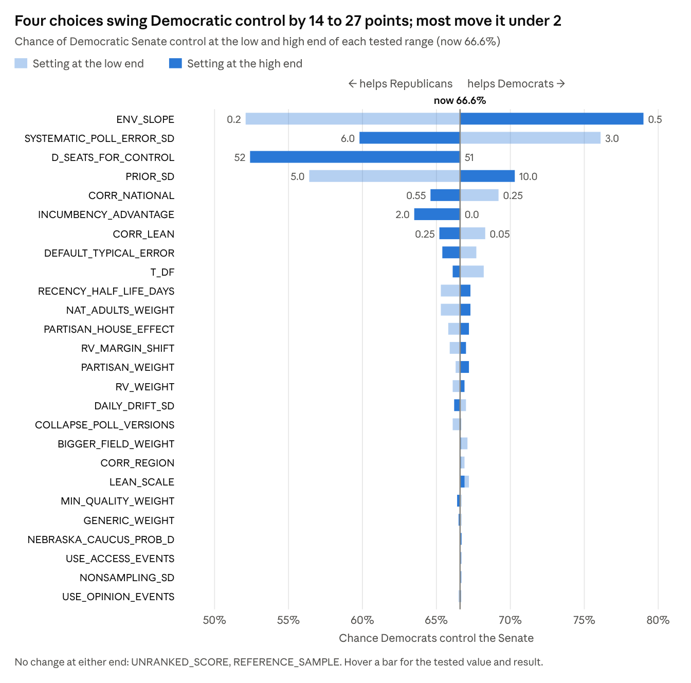

# Senate Forecast Model: Variables and Choices

Oct 15, 2026 · @Rylyn

## How to run the model

`senate_event_model.py` is our notebook as a single script. Every setting the group can change is in the SETTINGS block at the top of the file, and one command runs the whole forecast.

1. Keep `Midterm_Polls.xlsx`, `National_Polls.xlsx`, `leans_and_regions.csv` and `Events.xlsx` in a `data` folder next to `senate_event_model.py`, as the repo does. The script also finds them if they sit in its own folder.
2. Run `python senate_event_model.py`. It prints the chance Democrats control the Senate, the seat distribution and every race, then saves tables and charts to an `outputs` folder.
3. To try a value without editing the file, add `--set`, for example `python senate_event_model.py --set ENV_SLOPE=0.5 --set PRIOR_SD=5`.
4. Run `python senate_event_model.py --sweep` to test the settings. It reruns the model with each setting at a low and a high value and saves `outputs/sensitivity.csv`, which the chart below comes from.
5. `--today 2026-10-15` sets the forecast date (the default is today), and `--sims 40000` sets the number of simulated elections.

Every run uses the same random seed, so when a result changes, the setting caused it, not chance. The script needs numpy, pandas, scipy, matplotlib and openpyxl.

A margin is Democrat minus Republican, in points. A setting "helps D" when raising it increases the Democrats' chance of control.

## What moves the forecast most

*Source: `outputs/sensitivity.csv` from `python senate_event_model.py --sweep --today 2026-10-15`, 40,000 simulations per run. In the live doc, hovering a bar shows the tested value and result; the same numbers are in the CSV.*

If the darker bar lands right of the line, raising that setting helps Democrats. If it lands left, raising it helps Republicans. Three patterns account for almost every bar:

- **The national environment is the biggest choice.** Across the `ENV_SLOPE` range, Alaska, Iowa, Texas, Kansas and Ohio each move 20 to 25 points.
- **Trusting the polls helps Democrats.** In the Republican-held battlegrounds, the polls run ahead of the fundamentals. A wider `PRIOR_SD` trusts the polls more. A larger `SYSTEMATIC_POLL_ERROR_SD` or `DEFAULT_TYPICAL_ERROR` trusts them less and also adds uncertainty.
- **Spread settings don't change any race's odds.** `CORR_NATIONAL`, `CORR_LEAN` and `T_DF` make races move together more or less. Tighter links swing the seat total more, which pulls control toward 50-50.

## Every setting you can change

Each setting does one of four jobs, and the job tells you which way it pushes the forecast:

- **Lean** settings move race margins in one direction.
- **Trust** settings decide how much the polls count compared with fundamentals (partisan lean plus the national environment). In the Republican-held battlegrounds that decide control, the polls are 5 to 12 points more Democratic than the fundamentals. So trusting the polls more helps Democrats.
- **Spread** settings widen or narrow the uncertainty without moving any race's average. More uncertainty pulls the result toward 50-50, which hurts whoever is favored. Right now that is Democrats.
- **Rule** settings change how seats are counted.

"Raising it helps" is based on the October 15 data, with each setting moved from the low end of its range to the high end. "Neither" means the change was under half a point.

| Setting | Now | What it controls | Job | Raising it helps | Range tested | Basis for the current value |
| --- | --- | --- | --- | --- | --- | --- |
| `D_SEATS_FOR_CONTROL` | 51 | Seats Democrats need. The VP breaks a 50-50 tie for Republicans. 52 = one Democrat votes with Republicans | Rule | R | 51 to 52 | Starter notebook uses 51. The group model offers 52 as a Fetterman option |
| `NEBRASKA_CAUCUS_PROB_D` | 0.7 | Chance independent Dan Osborn sides with Democrats if he wins | Rule | Neither | 0.5 to 0.9 | Osborn says he will "caucus with everybody." The group model uses 0.8 |
| `RECENCY_HALF_LIFE_DAYS` | 14 | How old a poll is when it counts half | Lean | D. Older Alaska and Texas polls were more Democratic than recent ones | 7 to 30 | Forecasters shorten this late in a race. The group model uses 21 |
| `REFERENCE_SAMPLE` | 800 | Scales every poll's sample-size weight by the same amount | None | Neither | 400 to 1,600 | Only a scaling constant |
| `RV_WEIGHT` | 0.85 | How much a registered-voter poll counts compared with a likely-voter poll | Lean | D, slightly | 0.6 to 1.0 | `rv_lv_shift.py` gives 0.83 from 5 paired surveys |
| `RV_MARGIN_SHIFT` | +1.0 | Points added to registered-voter margins | Lean | D | −1 to +2 | `rv_lv_shift.py`: +0.80 (5 same-survey pairs). The within-pollster fit on the Silver Bulletin generic ballot file: +1.87 (SE 0.51). The group model uses −0.5 |
| `PARTISAN_WEIGHT` | 0.5 | How much party-sponsored polls count | Lean | D, slightly | 0.25 to 1.0 | The group model uses 0.6 |
| `PARTISAN_HOUSE_EFFECT` | 3.0 | Points moved against the sponsor's party. The data has 27 Republican-sponsored polls and 20 Democratic-leaning ones | Lean | D | 0 to 5 | [Silver Bulletin](https://www.natesilver.net/p/silver-bulletin-polling-average-methodology) starts partisan generic ballot polls at 1.7 points toward the sponsor. The group model uses 3.0 |
| `GENERIC_WEIGHT` | 0.3 | How much "generic Democrat vs. Republican" questions count | Lean | Neither | 0.1 to 0.6 | They leave out candidate effects. The group model uses 0.5 |
| `BIGGER_FIELD_WEIGHT` | 1.0 | How much full-field ballots (third parties named) count | Lean | Neither | 0.7 to 1.0 | 1.0 is neutral. The professor's hypothesis favors head-to-heads |
| `COLLAPSE_POLL_VERSIONS` | On | Counts one survey released several ways only once | Lean | D, slightly | Off or on | Stops Co/Efficient's single Nebraska sample from counting three times |
| `MIN_QUALITY_WEIGHT` | 0.4 | Weight of the lowest-rated pollster (rank 5). Rank 10 gets 1.0 | Lean | Neither | 0.2 to 0.8 | The group model uses 0.5 |
| `UNRANKED_SCORE` | 6.5 | Rank given to pollsters without one | None | Neither | 5 to 8 | Every poll in the current file has a rank, so this does nothing right now |
| `DEFAULT_TYPICAL_ERROR` | 5.0 | A single poll's average miss. The Typical Error column is blank, so this applies to every poll | Trust | R | 4 to 6 | Approximate late-race miss of a single Senate poll |
| `MAE_TO_SD` | 1.25 | Converts average miss into a standard deviation | None | Keep it fixed | — | Math constant (√(π/2) ≈ 1.25) |
| `SYSTEMATIC_POLL_ERROR_SD` | 4.5 | Miss shared by every poll in a state. Limits how sure the polls can make you | Trust and spread | R | 3 to 6 | Senate polls understated Democrats by a median of 2.1 points in 2022, a normal year ([Wang, 2022](https://election.princeton.edu/articles/pec-and-polling-performance-review-2022/)). The group model uses 4.5 |
| `ENV_SLOPE` | 0.35 | Turns presidential net approval (−22.9 now) into a national environment | Lean | D | 0.2 to 0.5 | 0.35 × 22.9 = D+8.0, close to the likely-voter generic ballot. The group model uses 0.35 |
| `NAT_ADULTS_WEIGHT` | 0.8 | How much all-adult approval polls count. Their average net approval is −28, compared with −20 for registered voters | Lean | D | 0.5 to 1.0 | The starter's value |
| `PRIOR_SD` | 7.0 | How far a race can stray from lean plus environment before the polls come in | Trust | D | 5 to 10 | No candidate term in the prior argues for a wide one. The group model uses 7.5 |
| `INCUMBENCY_ADVANTAGE` | 0 (off) | Points for an elected incumbent who is running, and half that for an appointed one. Battleground incumbents running are mostly Republicans | Lean | R | 0 to 2 | The edge has declined ([Jacobson, 2015](https://doi.org/10.1086/681670)). The group model uses 2.0 |
| `DAILY_DRIFT_SD` | 0.28 | Opinion movement per day left. With 19 days left, that adds 1.2 points | Spread | R, slightly | 0.15 to 0.40 | The group model uses 0.25 |
| `T_DF` | 8 | Tail thickness. Lower values mean more upsets | Spread | R (raising it thins the tails) | 4 to 30 | The group model uses 5 |
| `CORR_NATIONAL` | 0.40 | Error that every state shares | Spread | R | 0.25 to 0.55 | Midterm misses are patchier than presidential-year misses. The group model uses 0.45 |
| `CORR_REGION` | 0.15 | Extra shared error within a Census region | Spread | Neither | 0.05 to 0.25 | Starter value |
| `CORR_LEAN` | 0.15 | Extra shared error for states with similar lean | Spread | R | 0.05 to 0.25 | Starter value |
| `LEAN_SCALE` | 8 | Lean gap at which that similarity falls to 37% | Spread | Neither | 4 to 15 | The group model uses 10 |
| `USE_OPINION_EVENTS` | On | News shocks from the Opinion sheet | Lean | Neither | Off or on | `Events.xlsx` |
| `USE_ACCESS_EVENTS` | On | Voting-access changes marked active | Lean | Neither | Off or on | `Events.xlsx` |
| `NONSAMPLING_SD` | 2.0 | Extra poll-to-poll noise used when estimating an event from polls | Trust (events only) | Neither | 1 to 3 | Assumption |
| `HOUSE_DISTRICT_SD` | 5.0 | District noise in the House map module | None for the Senate | — | — | House only |

`N_SIMS` and `SEED` change precision, not direction. With 40,000 simulations, chance alone moves a 50% probability by about 0.25 points.

## Event and voting-access settings (Events.xlsx)

Together, the four opinion events and the five real access changes move Democratic control by about a tenth of a point. Events matter much less than the main settings above. The table lists the columns you fill in for each event and which way each one pushes.

| Sheet | Column | What it does | Raising it helps |
| --- | --- | --- | --- |
| Opinion | `prior_mean` | Your guess of the event's effect on the margin, in points. Positive means toward Democrats | D |
| Opinion | `prior_sd` | How unsure you are about that guess. A larger value lets the polls overrule it and adds uncertainty | Toward whatever the polls show |
| Opinion | `estimate_from_polls` | Yes = check the guess against the same pollster's polls before and after the event | — |
| Opinion | `window_days` | How many days on each side of the event to look for those before-and-after pairs | — |
| Opinion | `half_life_days` | Blank = the effect is permanent. A number = the effect fades by half over that many days | Shrinks the effect by Election Day |
| Opinion | `scope` | `national`, a list of states separated by `;`, or `region:<Region>` | — |
| Access | `affected_share` | Share of the electorate facing the new rule | R when `lean_gap` is positive |
| Access | `lean_gap` | How much more Democratic the affected voters are than their state, in points. Negative = they lean Republican | R |
| Access | `deterrence_mean` | Share of affected voters who end up without a counted ballot | R when `lean_gap` is positive |
| Access | `countermobilization_mean` | Share of that loss offset by backlash turnout | D when `lean_gap` is positive |
| Access | `in_polls_share` | Share of the effect already reflected in likely-voter screens | Shrinks the effect |
| Access | `p_in_effect` | Chance the rule is in force on Election Day (for laws in court) | Scales the effect |
| Access | `active` | Yes = included in the main forecast. No = shown only as a scenario | — |

What the event choices did on October 15:

- **Opinion events.** The polls pulled the early-October national news event (OP1) from your +0.5 guess to −0.19. North Carolina (OP2) stayed near +0.5, because only 2 poll pairs exist. Kansas (OP3) has no pairs, so it stays at 0.
- **Real access changes.** Ohio's end of the mail ballot grace period is the largest, at −0.025 points in Ohio. Every active row combined moves Democratic control by under 0.1 points.
- **Scenarios.** These are not in the forecast. The largest is a severe nationwide documentation rule (HYP2: 10% of voters affected, 25% deterred), which cuts Democratic control by 5.1 points. Running every scenario at once cuts it by 6.2 points.
- **Size check.** To move control by 10 points, about 4% of the national electorate would have to lose their ballots, and those voters would have to be 20 points more Democratic than their states. A shock that size against Republican-leaning voters raises control by 9 points.
- **Redrawn maps** change Senate margins by 0, because Senate races are statewide. They feed only the House module, which still runs on toy data.

## Decisions for the group, biggest first

Only the first five decisions can move Democratic control by more than 3 points. Every setting below them moves it by about 2 points or less, so they are not worth long debates.

| # | Decision | Settings | Suggested start | Why |
| --- | --- | --- | --- | --- |
| 1 | How strong is the national environment? | `ENV_SLOPE` | Your likely-voter generic ballot margin ÷ 22.9 (0.35 gives D+8.0) | This is the biggest lever. Tie it to a number you can defend, rather than picking the slope directly |
| 2 | How much do we believe the polls? | `PRIOR_SD`, `SYSTEMATIC_POLL_ERROR_SD`, `DEFAULT_TYPICAL_ERROR` | 7, 4.5 and 5 (current) | This really asks whether Democrats are actually competitive in Alaska, Iowa, Texas, Ohio and Kansas, where the polls run 5 to 12 points ahead of the fundamentals. Decide the three settings together |
| 3 | Do Democrats need 51 or 52? | `D_SEATS_FOR_CONTROL` | 51 | The official rule. Use 52 only if you have a specific reason to expect a Democratic senator to side with Republicans, and say so |
| 4 | How much do states miss together? | `CORR_NATIONAL`, `CORR_LEAN`, `T_DF`, `DAILY_DRIFT_SD` | Current values | These don't change who is favored in any race, only how confident the forecast is. They matter if the workshop scores probabilities, and not if it scores race calls or seat counts |
| 5 | Should incumbents get a bonus? | `INCUMBENCY_ADVANTAGE` | 2, matching the group model | Maine shows the gap: fundamentals say D+16, the polls say D+2.3. The prior misses Collins's personal vote. Check the incumbent list in the script, which is copied from the group model, before turning this on |
| 6 | How fast should old polls fade? | `RECENCY_HALF_LIFE_DAYS` | 14 now, 7 in the final week | Forecasters shorten the half-life as Election Day nears |
| 7 | Should all-adult approval polls count? | `NAT_ADULTS_WEIGHT` | 0.8 | Only 2 approval polls are likely-voter, so adult polls carry the average. They run 8 points more negative than registered-voter polls |
| 8 | How far apart are registered and likely voters? | `RV_MARGIN_SHIFT`, `RV_WEIGHT` | +1.0 and 0.85 | Between our two estimates (+0.80 and +1.87). Only 11 of 232 state polls are registered-voter polls, so the effect is small |
| 9 | How biased are sponsored polls? | `PARTISAN_HOUSE_EFFECT`, `PARTISAN_WEIGHT` | 3.0 and 0.5 | Silver Bulletin's 1.7 is the low end. Republican-sponsored polls outnumber Democratic ones, so a larger correction helps Democrats a little |

The group model also makes two choices this model doesn't: it allocates undecided voters and blends in the generic ballot. If the two forecasts disagree, compare those choices first.

## References

Jacobson, G. C. (2015). It's nothing personal: The decline of the incumbency advantage in US House elections. *The Journal of Politics, 77*(3), 861–873. <https://doi.org/10.1086/681670>

Silver, N., & McKown-Dawson, E. (2026, January 22). *How Silver Bulletin calculates our polling averages*. Silver Bulletin. <https://www.natesilver.net/p/silver-bulletin-polling-average-methodology>

Wang, S. (2022, November 20). *PEC (and polling) performance review, 2022*. Princeton Election Consortium. <https://election.princeton.edu/articles/pec-and-polling-performance-review-2022/>

Data: the professor's `Midterm_Polls.xlsx` (October 15 version), `National_Polls.xlsx` and `leans_and_regions.csv`. Registered-voter estimates come from our `rv_lv_shift.py` and `RV_LV_pairs.xlsx`.
